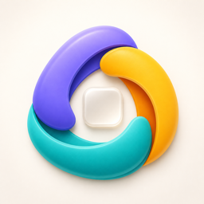
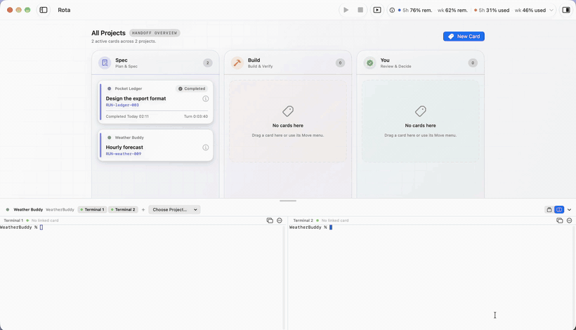
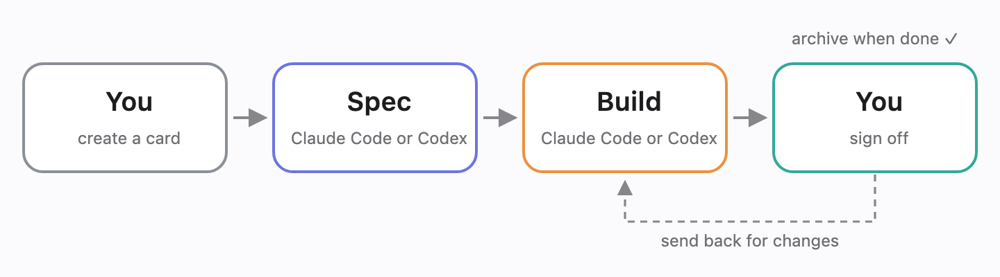
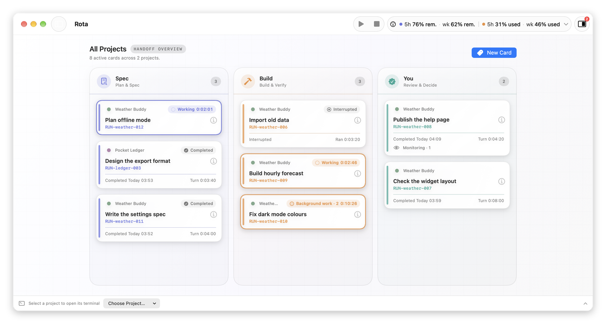
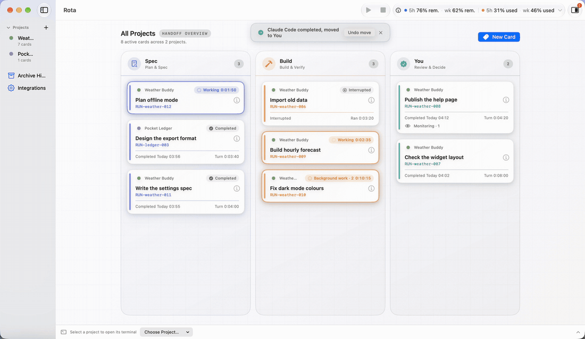
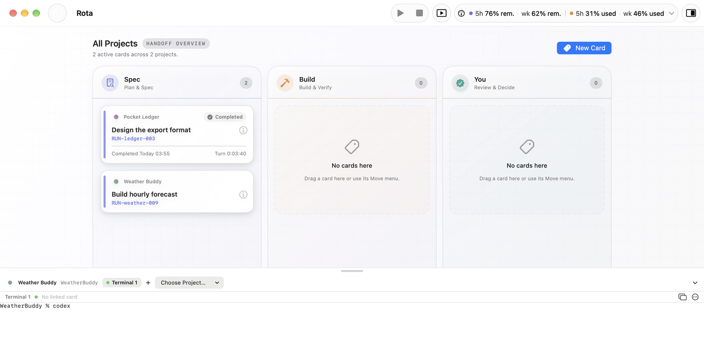
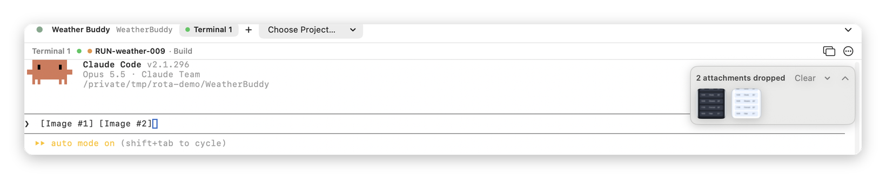
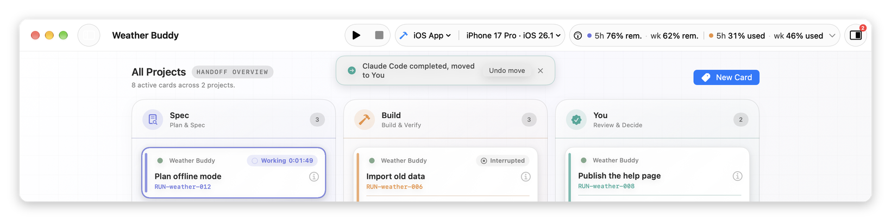

  

<h1 align="center">Rota</h1>

  <b>A multi-agent board built around Spec-Driven Development (SDD)</b> 
  Claude Code and Codex work together through spec, build and review. Who is working on what, how far it has got, and who goes next, all on one screen.

  <a href="README.md">繁體中文</a> ｜ <b>English</b>

  
  
  

  

  <a href="../../releases/latest"><b>Download Rota (.dmg)</b></a>

**Install**: open the downloaded `.dmg` → drag Rota into Applications → open Rota from Applications.

---

## What Rota does

### Work is split the Spec-Driven Development way

  

In Spec-Driven Development (SDD), you write the spec first, build to the spec, then check the result against it. Rota turns those three stages into three lanes on the board: Spec, Build and You. Each piece of work is a card that moves through them in order.

- **Spec** and **Build** belong to the agents. Claude Code and Codex can each take either one: Codex can write the spec and Claude Code build it, or the other way round.
- **You** is yours: check the result against the spec, then send it back for changes or archive it as done.
- Claude Code and Codex still write the specs and the code. Rota handles who does what and keeps track of it, so you always know whose turn it is and how far it has got.

### Cards follow Claude Code and Codex as they work

  

- Once a Session is linked, its card moves to that lane when Claude Code or Codex starts working, and is marked finished when the turn ends. You don't drag anything.
- The bottom of each card shows how long this turn took and when it finished. Background work and watching for outside events are shown on the card too.

### When a turn finishes, the edges of your screen light up

  

- When a turn finishes, the edges of every display glow for a few seconds, then fade out. Blue means a Spec finished, orange means a Build finished.
- The glow never takes keyboard focus and can't be clicked, so it doesn't interrupt what you're doing. With Reduce Motion on, it only fades in and out.
- You can change how long it lasts and which Sessions trigger it, or turn it off, in Settings.

### A built-in terminal that links the Session to a card as it starts

  

- Every project has its own terminal. Type `claude` or `codex` there and Rota asks, right above the terminal, which card to link to and whether it's the Spec or the Build.
- For Codex, Rota asks before you send the first prompt. Choose first, and the link completes when you send it.
- You can open several terminals in one project and link each to a different card without them getting mixed up.

### Drop images into the terminal and preview them before sending

  

- Drag a screenshot or image into a Rota terminal and it reaches Claude Code or Codex as an attachment, just like dropping a file in Terminal.app. Images dragged from a browser work too.
- An attachment tray appears in the terminal's top-right corner with thumbnails. Click one to open it in Quick Look and check it's the right image before you send.
- Once the Hook confirms the send, the attachments in the tray are marked Sent.

### Run iOS and Android apps from the toolbar

  

- After you add an app in Project Settings, Run and Stop appear in the toolbar. Destinations include an iPhone, iOS simulators, your Mac, Android phones and Android emulators.
- An Android phone needs a cable only once, to turn on wireless use. After that, runs go over the phone's hotspot or the same Wi-Fi.
- Running an app doesn't use the project's terminal. One app runs at a time, and Rota asks before switching.

### See Claude Code and Codex usage in the toolbar

  

- The usage panel in the toolbar shows the remaining 5-hour and weekly usage for Claude Code and Codex, so you can decide who takes the next turn.
- Claude Code usage has to be turned on separately; see the [guide](docs/guide.en.md#usage).

## Getting started

1. **Add a project**: press **+** in the sidebar and choose the project folder.
2. **Turn on the integrations**: on first launch a setup panel appears; press **Enable Integration…**. If you use Codex, also run `/hooks` in Codex once to approve. See [First-time setup](docs/setup.en.md).
3. **Add a card**: press **New Card** (⌘N) on the board and write what the work is.
4. **Start Claude Code or Codex**: type `claude` or `codex` in the project's terminal.
5. **Link the card**: when the banner appears above the terminal, choose a card, then **Spec** or **Build**.

Everything after that, such as running several terminals, linking Sessions you skipped, and setting up app runs and wireless Android, is in the [guide](docs/guide.en.md).

## Guide

| Topic | What it covers |
|---|---|
| [First-time setup](docs/setup.en.md) | Turning on the integrations, approving Codex `/hooks`, checking that it works |
| [Linking cards](docs/guide.en.md#linking-cards) | Linking Claude Code and Codex, Later and Don't, replacing a linked Session, Undo |
| [Unassigned Sessions](docs/guide.en.md#unassigned-sessions) | Sessions started in other terminal apps or not linked yet, and how to link them later |
| [Several terminals at once](docs/guide.en.md#several-terminals-at-once) | Several Claude Code or Codex terminals in one project, and Codex standalone mode |
| [Reading a card](docs/guide.en.md#reading-a-card) | Running, finished, background work, watching, this turn's time, marking a turn interrupted, archiving |
| [Completion glow](docs/guide.en.md#completion-glow) | On and off, duration, linked cards only |
| [Usage](docs/guide.en.md#usage) | Turning on Claude Code account usage, reading the usage panel |
| [Running apps](docs/guide.en.md#running-apps) | Adding an app in Project Settings, destinations, the run log, when an iPhone is greyed out |
| [Wireless Android](docs/guide.en.md#wireless-android) | Hotspot and Wi-Fi, pairing codes, after the phone restarts |
| [Integrations need updating](docs/guide.en.md#integrations-need-updating) | What to do when this appears after updating Rota |

## Privacy and trust

> - **Files it changes**: only `~/.claude/settings.json` and `~/.codex/hooks.json`. Rota adds its own entries only, backs up each file first, and never touches your other hooks.
> - **Never read**: prompts, code, conversations or tool output.
> - **Never uploaded**: everything stays on your Mac. No analytics, no server.
> - **Fully removable**: press **Uninstall** in the app and Rota's entries are removed; everything else stays as it was.
>
> Details: [Privacy](docs/privacy.en.md)

## Requirements

| | |
|---|---|
| macOS | 15 or later, Apple silicon or Intel |
| AI CLI | At least one, installed and signed in: [Claude Code](https://docs.anthropic.com/claude-code) or [Codex CLI](https://github.com/openai/codex) |
| Optional: run iOS apps | Xcode |
| Optional: run Android apps | Android Studio (or the Android SDK and a JDK) |

## Updating and removing

- **Update**: download the new `.dmg` from [Releases](../../releases/latest) and replace Rota. Your data is kept. If Rota says the integration needs an update, press **Update…** once.
- **Remove**: uninstall the integration in **Settings → Agent Integrations** first, then delete the app. See [Uninstall](docs/uninstall.en.md).

## FAQ

I started <code>codex</code> in a terminal but no link suggestion appeared

Check that Codex is enabled in **Settings → Agent Integrations** and does not need an update. New Codex hooks must be approved once with `/hooks` inside Codex. More in the [FAQ](docs/faq.en.md).

A card keeps saying "waiting for background work"

The AI still has work running in the background, such as a subagent or a background command. The card completes when it finishes. A *monitor* that only waits for an outside event never holds a card; the card shows "Monitoring" instead.

My iPhone is greyed out in the destination menu

The app needs a newer iOS than the phone has; the menu says "Requires iOS xx". Lower Minimum Deployments in Xcode, or update the phone.

Running on an Android phone without a cable

Plug the phone in by USB once and choose **Use Without a Cable** in the destination menu. After that, connect this Mac to the phone's hotspot or the same Wi-Fi. After the phone restarts, plug it in once again.

More: [FAQ](docs/faq.en.md)

## Reporting a problem

Open an [issue](../../issues/new/choose) with the bug report form. Include your macOS version, your Rota version (**Rota → About Rota**) and a screenshot. **Never paste API keys or other secrets.**

## Changelog, licence and notices

- [Changelog](CHANGELOG.md)
- [Licence](LICENSE): free to download and use; the source code is not published.
- Rota is an independent project and is not affiliated with OpenAI or Anthropic. Claude and Claude Code are trademarks of Anthropic. Codex is a trademark of OpenAI.

© 2026 Yung Fu Lin. All rights reserved.
