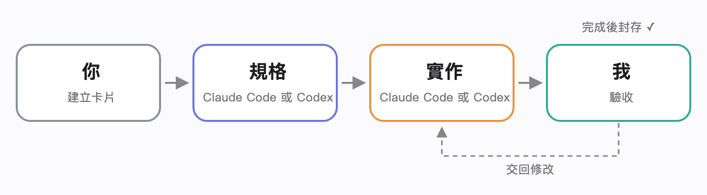
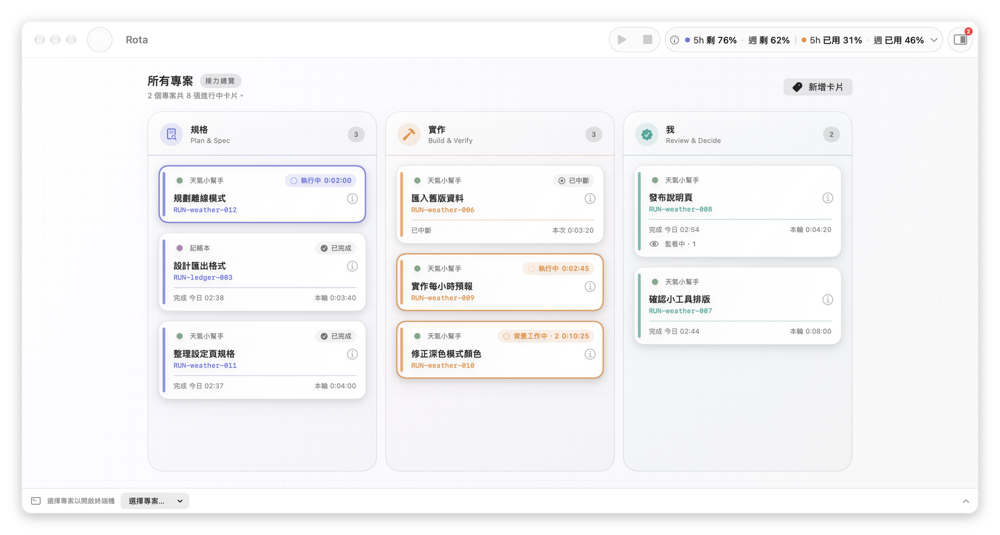
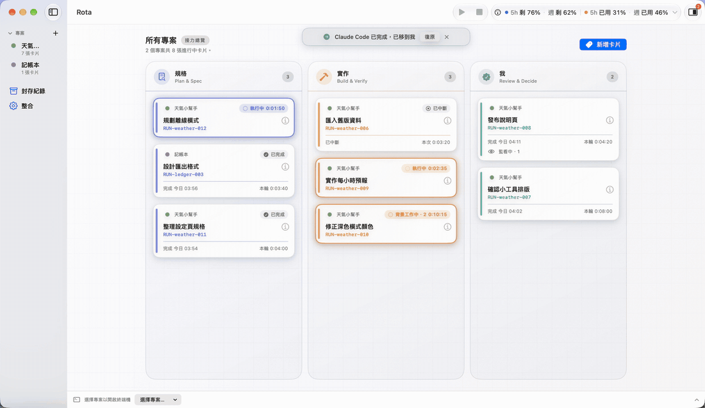
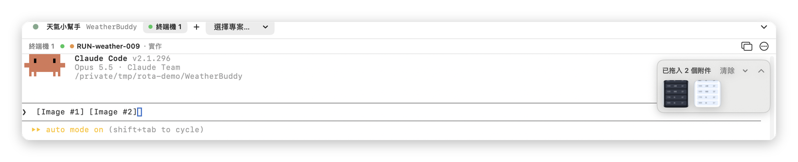
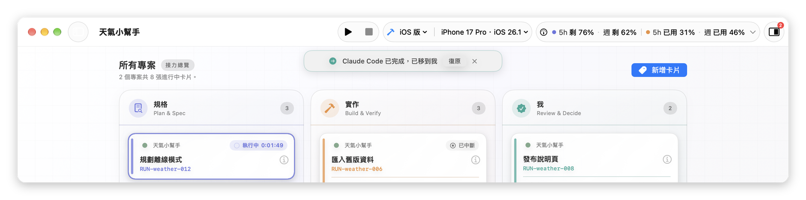

  

<h1 align="center">Rota</h1>

  <b>以規格驅動開發（SDD）流程為核心的多 Agent 協作看板</b> 
  讓 Claude Code 和 Codex 依「規格 → 實作 → 驗收」分工協作。誰在做哪件事、做到哪裡、下一步該交給誰，都在同一個畫面上。

  <b>繁體中文</b> ｜ <a href="README.en.md">English</a>

  
  
  

https://github.com/user-attachments/assets/f956e675-ba0a-4541-baae-687fc1f472bd

  <a href="../../releases/latest"><b>下載 Rota（.dmg）</b></a>

**安裝**：打開下載的 `.dmg` → 把 Rota 拖進「應用程式」→ 從「應用程式」開啟 Rota。

---

## Rota 能做什麼

### 依規格驅動開發（SDD）的流程分工

  

規格驅動開發（Spec-Driven Development，SDD）的做法是先把規格寫清楚，再照規格實作，最後對照規格驗收。Rota 把這三個階段做成看板上的三條河道：規格、實作、我。每件工作是一張卡片，依序往下走。

- **規格**與**實作**由 Agent 負責。Claude Code 和 Codex 都可以接任何一棒，例如讓 Codex 寫規格、Claude Code 實作，也可以反過來。
- **我**這一欄留給你：對照規格驗收結果，決定要交回去修改，還是完成封存。
- 規格和程式還是由 Claude Code、Codex 自己寫。Rota 負責分工與追蹤，讓你隨時知道每一棒在誰手上、進行到哪裡。

### 卡片跟著 Claude Code 和 Codex 的進度移動

  

- 連結好之後，Claude Code 或 Codex 開始工作，卡片就移到它負責的那條河道；做完一輪，卡片會標示完成。你不需要手動拖曳。
- 卡片底部記錄這一輪花了多少時間、幾點完成。還有背景工作在跑、或正在監看外部事件時，卡片上也會標出來。

### 完成時，螢幕邊緣會亮起光暈

  

- 完成一輪時，所有螢幕的邊緣會亮起光暈，持續幾秒後收回。規格完成是藍色，實作完成是橘色。
- 光暈不會搶走鍵盤焦點，也點不到，所以不會打斷你正在做的事。開啟「減少動態效果」時，光暈只會淡入淡出。
- 光暈的時間長短和觸發範圍都可以在設定中調整，也可以關閉。

### 內建終端機，開啟時就把 Session 連到卡片

https://github.com/user-attachments/assets/d0ed8a3a-80de-4278-ac65-53a6f51336de

- 每張卡片最多可以開兩個終端機。新增卡片時選好的 Agent 會自動連結到這張卡片；在卡片的終端機裡自己輸入 `claude` 或 `codex`，上方會問要連結成這張卡片的規格還是實作。
- Codex 在送出第一個 prompt 之前就先預先連結，送出第一個 prompt 時自動完成。Rota 無法確定時，終端機上方會問你要連結到哪張卡片。
- 面板上方的「選擇卡片…」列出所有卡片，有終端機的排在前面；好幾張卡片同時開著終端機，也不會互相搞混。

### 把圖片拖進終端機，送出前先預覽

  

- 把截圖或圖片拖進 Rota 的終端機，就會以附件的方式交給 Claude Code 或 Codex，就像在 Terminal.app 裡拖入檔案一樣。從瀏覽器拖來的圖片也可以。
- 終端機右上角會出現附件托盤，顯示縮圖。點一下縮圖，就能用「快速查看」看大圖，確認拖對了再送出。
- 送出後，Rota 從 Hook 確認這次送出，托盤上的附件會標示「已送出」。

### 在工具列直接執行 iOS 和 Android App

  

- 在專案設定中加入 App 之後，工具列會出現執行和停止按鈕。目的地可以選 iPhone、iOS 模擬器、Mac、Android 手機或 Android 模擬器。
- Android 手機只需要第一次用線接上並開啟「不接線使用」，之後透過手機熱點或同一個 Wi-Fi 就能執行。
- 執行 App 不會占用終端機。同一時間只執行一個 App，要換另一個時會先詢問。

### 在工具列查看 Claude Code 和 Codex 的用量

  

- 工具列可以打開用量面板，查看 Claude Code 和 Codex 的 5 小時與每週剩餘用量，決定下一棒要交給誰。
- Claude Code 的用量需要在設定中另外開啟，做法見[使用指南](docs/guide.md#用量)。

## 開始使用

1. **新增專案**：按側邊欄的「＋」，選擇專案資料夾。
2. **啟用整合**：第一次開啟時，主視窗上方會出現提示卡「連接 Claude Code 與 Codex」。勾選「我已停止所有執行中的 Codex 與 Claude Code 任務」，再按「同意並安裝」。使用 Codex 的話，還要在 Codex 裡執行一次 `/hooks` 核准。詳細步驟見[第一次設定](docs/setup.md)。
3. **新增卡片**：在看板上按「新增卡片」（⌘N），寫下這件工作的內容。
4. **開啟 Claude Code 或 Codex**：在同一個表單的「規格由」「實作由」選 Claude Code 或 Codex，按「儲存」。Rota 會開好這張卡片的終端機、啟動 Agent，並自動連結到這張卡片。
5. **之後再開**：在卡片上按右鍵，選「一鍵開啟規格與實作…」，分別選規格和實作要用的 Agent，就會開好並自動連結。也可以選「開啟終端機」開一個純終端機，自己輸入 `claude` 或 `codex`，再在上方選「規格」或「實作」。

之後的操作，例如同時開好幾個終端機、處理沒有連結到的 Session、設定執行 App 與 Android 不接線，都寫在[使用指南](docs/guide.md)裡。

## 使用指南

| 主題 | 內容 |
|---|---|
| [第一次設定](docs/setup.md) | 啟用整合、Codex 的 `/hooks` 核准、確認設定成功 |
| [連結卡片](docs/guide.md#連結卡片) | Claude Code 與 Codex 的連結流程、稍後與不要、取代已連結的 Session、復原 |
| [待配對 Session](docs/guide.md#待配對-session) | 在其他終端機 App 啟動，或當下沒有連結的 Session，之後怎麼連結 |
| [同時開好幾個終端機](docs/guide.md#同時開好幾個終端機) | 同一個專案多個 Claude Code 或 Codex，以及 Codex 的獨立模式 |
| [看懂卡片](docs/guide.md#看懂卡片) | 執行中、已完成、背景工作、監看中、本輪時間、標記本輪已中斷、封存 |
| [完成光暈](docs/guide.md#完成光暈) | 開關、持續時間、只對已連結卡片顯示 |
| [用量](docs/guide.md#用量) | 開啟 Claude Code 帳號用量、看懂用量面板 |
| [執行 App](docs/guide.md#執行-app) | 在專案設定加入 App、選擇目的地、執行紀錄、iPhone 灰掉時怎麼辦 |
| [Android 不接線執行](docs/guide.md#android-不接線執行) | 熱點與 Wi-Fi、配對碼、手機重開機之後 |
| [整合需要更新](docs/guide.md#整合需要更新) | 更新 Rota 之後出現提示時怎麼處理 |

## 隱私與信任

> - **會改動的檔案**：只有 `~/.claude/settings.json` 與 `~/.codex/hooks.json`。Rota 只加入自己的條目，改之前會先備份，你自己的其他 hook 不會被動到。
> - **不讀取**：prompt、程式碼、對話內容、工具輸出。唯一例外：附加圖片後，Rota 只從終端機輸入列辨識 `[Image #N]` 這個標記，不保存其他內容。
> - **不上傳**：所有資料都留在你的 Mac 上，沒有使用統計，也不會傳到任何伺服器。只有自動更新會向 GitHub 讀取版本資訊，可以在設定中關閉。
> - **可以完全移除**：在 App 內按「解除安裝」，Rota 加入的條目會被移除，其他設定維持原樣。
>
> 完整說明：[隱私](docs/privacy.md)

## 系統需求

| 項目 | 需求 |
|---|---|
| macOS | 15 以上，Apple Silicon 與 Intel 都可以 |
| AI CLI | 至少一個：[Claude Code](https://docs.anthropic.com/claude-code) 或 [Codex CLI](https://github.com/openai/codex)，已安裝並登入 |
| 選用：執行 iOS App | Xcode |
| 選用：執行 Android App | Android Studio（或 Android SDK 與 JDK） |

## 更新與移除

- **更新**：從 1.1.0 起，Rota 每次開啟時會檢查新版本，在背景下載，結束 Rota 時自動安裝；看板上也會出現「立即重新啟動」，可以馬上更新。可以在「設定 → 進階與診斷 → 更新」關閉自動更新，或按「檢查更新…」。從 1.0.0 升級時，請手動到 [Releases](../../releases/latest) 下載一次新的 `.dmg`，覆蓋舊的 Rota，資料會保留。如果 Rota 顯示「整合需要更新」，按一次「更新…」就好。
- **移除**：先在「設定 → Agent 整合」解除安裝整合，再刪除 App。步驟見[完全移除](docs/uninstall.md)。

## 常見問題

終端機開了 <code>codex</code>，但沒有跳出連結卡片的提議

請先確認「設定 → Agent 整合」中的 Codex 已啟用，而且沒有「需要更新」。新的 Codex hook 需要在 Codex 中執行 `/hooks` 核准一次。更多說明見[常見問題](docs/faq.md)。

卡片一直顯示「等待背景工作」

代表 AI 還有在背景執行的工作，例如 subagent 或背景指令。等它們結束，卡片就會完成。只是在等外部事件的「監看」不會讓卡片卡住，卡片上會顯示「監看中」。

我的 iPhone 在目的地選單中是灰的

App 要求的最低 iOS 版本比手機的版本新。選單上會寫「需要 iOS xx」。請在 Xcode 調低 Minimum Deployments，或更新手機。

Android 手機想不接線執行

第一次要先用 USB 接上，在目的地選單選「不接線使用」。之後只要 Mac 連上手機的熱點或同一個 Wi-Fi 就能執行。手機重新開機後，需要再插一次線。

更多問題：[常見問題](docs/faq.md)

## 回報問題

請到 [Issues](../../issues/new/choose) 選擇「回報問題」，並附上 macOS 版本、Rota 版本（「Rota → 關於 Rota」），以及問題截圖。**請勿貼上 API key 或其他私密資訊。**

## 更新紀錄、授權與聲明

- [更新紀錄](CHANGELOG.md)
- [授權條款](LICENSE)：可以免費下載使用，不開放原始碼。
- Rota 是獨立開發的作品，與 OpenAI、Anthropic 沒有任何關係。Claude、Claude Code 是 Anthropic 的商標；Codex 是 OpenAI 的商標。

© 2026 Yung Fu Lin. 保留所有權利。
