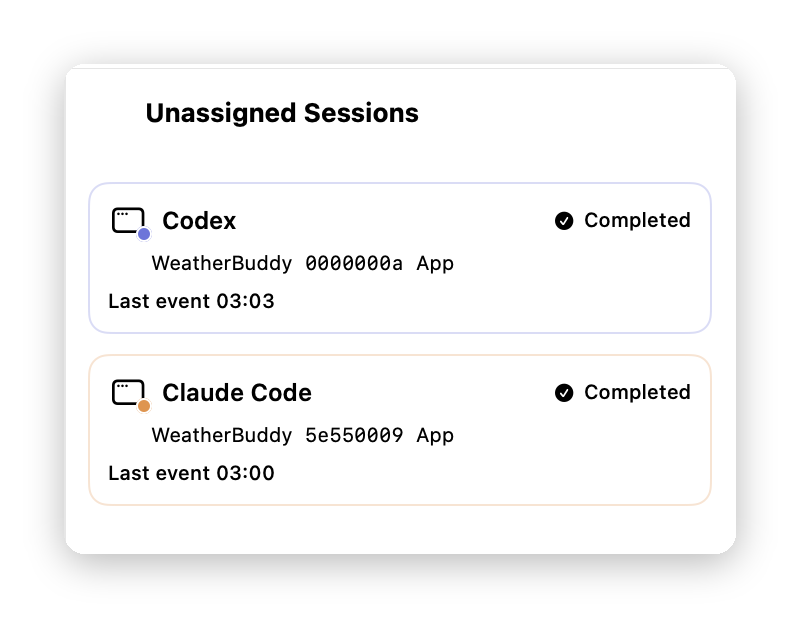
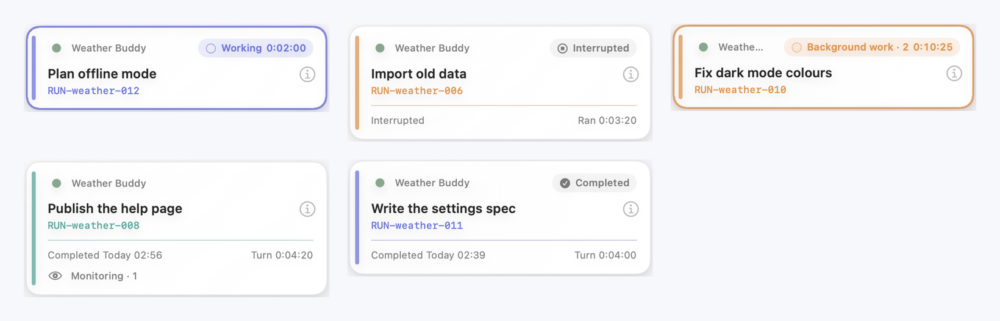
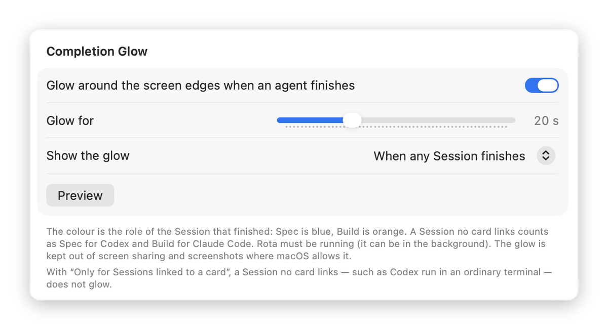
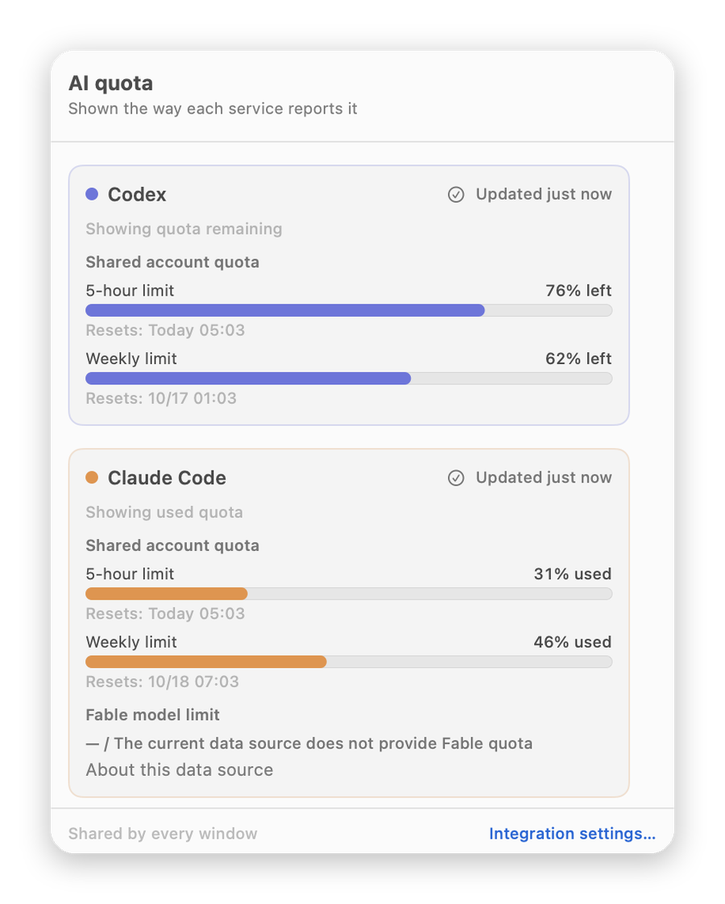
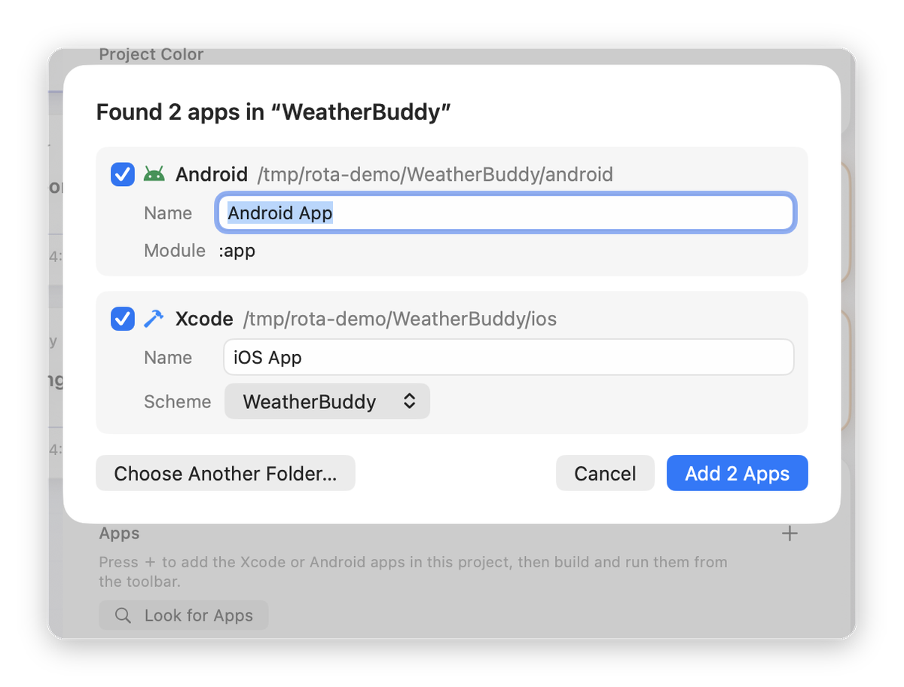
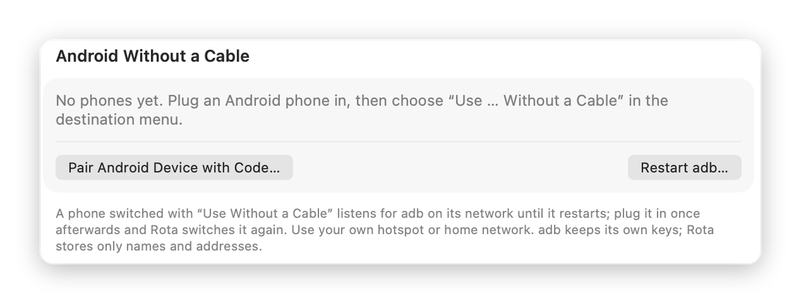
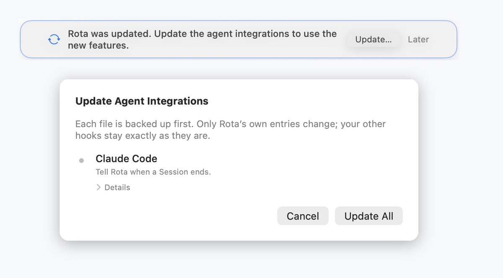

# Guide

[← Back to home](../README.en.md) ｜ [繁體中文](guide.md)

This page covers the parts of Rota that need some explaining. If you haven't finished setup yet, start with [First-time setup](setup.en.md).

- [Linking cards](#linking-cards)
- [Unassigned Sessions](#unassigned-sessions)
- [Several terminals at once](#several-terminals-at-once)
- [Reading a card](#reading-a-card)
- [Completion glow](#completion-glow)
- [Usage](#usage)
- [Running apps](#running-apps)
- [Wireless Android](#wireless-android)
- [Integrations need updating](#integrations-need-updating)

## Linking cards

A card follows a Claude Code or Codex Session only after the Session is linked to it. Each card has a Spec slot and a Build slot, and each slot holds one Session.

### Card terminals

Rota's terminals belong to cards, at most two per card. A card's terminals are plain terminals, not Spec or Build terminals; once an Agent in one is linked, its tab and the mark on the card read "Spec · Codex" and so on, otherwise "Terminal 1" and "Terminal 2".

- **When you add a card**: choose Claude Code or Codex under **Spec by** and **Build by**. After you save, Rota opens one terminal for each role you chose an Agent for, types `claude` or `codex`, and links it to this card in that role without asking. The form remembers your last choice.
- **Both at once, later**: right-click the card and choose **Open Spec and Build…**, pick an Agent for Spec and for Build, and press **Open**. As with the New Card form, each links to its role without asking, and the choices are the form's. The item is greyed out when the card already has two terminals; with one place left you can choose only one row. If a role you chose is already linked, its row says "Linked to Session … (running / state unknown / ended)", and **Open** first asks with the same alert: only **Replace and Open** opens; **Cancel** opens nothing.
- **A plain terminal**: choose **Open Terminal** from the card's menu or its details, or press **Open Terminal** or **+** in the panel. With two open, it only shows them.
- **Switching the panel**: click a card, the terminal mark on it, or a card in **Choose Card…** at the top of the panel, and the bottom panel shows that card's terminals — or, before it has any, **Open Terminal**; nothing starts until you press it.
- **Choose Card…**: on the all-projects board, **Terminals Open** comes first — the cards with terminals open, as "Project - Card", one click away — then **All Projects**, with a submenu per project listing its cards, those with terminals first. On a single project's board the menu has one level. The card shown, and its project, are ticked.
- **Panel title**: "Project › Card", following a rename; when space is short, the project name shortens first.
- **Good to know**:
  - an Agent whose integration is off is greyed out;
  - if no Agent is seen within 30 seconds, a note above the terminal asks you to check that it is installed;

### When Rota asks

When you type `claude` or `codex` yourself in a card's terminal, Rota asks above that terminal every time: link it as this card's **Spec** or **Build**? Only this card is offered. Agents opened from New Card or **Open Spec and Build…** aren't asked — unless another Session took that role after you chose (running or ended); then Rota asks and says why.

### Claude Code

https://github.com/user-attachments/assets/b40525f2-1652-4b5c-8a3e-6a2052a866d3

The interface in this video is in Traditional Chinese.

1. Start `claude` in a card's terminal.
2. "Claude Code started in this card's terminal. Link it as Spec or Build?" appears above the terminal.
3. Press **Spec · Claude Code** or **Build · Claude Code**. The role this terminal linked last stands out, but nothing links until you press one.
4. If that role has no link yet, pressing it links. If another Session holds it — still running or already ended — an alert first asks in the middle of the window; see [Replacing a linked Session](#replacing-a-linked-session).
5. Rota shows "Linked to …". For 6 seconds you can press **Undo** to take the link back. The tab now reads "Spec · Claude Code" or "Build · Claude Code".

### Codex

https://github.com/user-attachments/assets/0cea3bec-33e9-4fc3-9ba6-6a15d3cc644a

The interface in this video is in Traditional Chinese.

Codex doesn't create a Session until you send the first prompt, so Rota asks as soon as Codex opens:

1. Type `codex` in a card's terminal and press Return.
2. Within one to three seconds, "Codex opened in this card's terminal. Link it as Spec or Build?" appears above the terminal.
3. Choose **Spec** or **Build** (replacing a linked Session asks first, with the same alert). The banner changes to "Pre-linked to … Waiting for Codex's first prompt."
4. Send your first prompt as usual. The link completes by itself; there's nothing else to press.

If you press **Cancel** or quit Codex before sending a prompt, the pre-link is dropped and nothing is linked.

### Later and Don't Ask

- **Later**: hides the banner for now. To bring it back, open the terminal's **⋯** menu and look under **Session pairing**: **Pair (Session ID)…** for Claude Code, or **Choose a card for this terminal's Codex…** for Codex.
- **Don't Ask**: only on the banner shown when Codex opens. Rota stops asking about this Codex; after the first prompt, its Session still gets the usual link suggestion.
- Any Session that isn't linked stays in [Unassigned Sessions](#unassigned-sessions), and you can link it later.

### Replacing a linked Session

In a card's terminal, a role that is already linked says which Session holds it and its state under its button, such as "Linked to Session … (running)". Choose such a role and — whether the old Session is running, of unknown state or has ended — an alert asks first, in the middle of the window: "Replace the currently linked Session?", naming the card, the role, the Session it replaces and its state. Only **Replace and Link** replaces the link, and for 6 seconds you can press **Undo**; **Cancel** or Esc goes back to the question with nothing changed. Return doesn't replace, and **Cancel** starts with the focus, so Space doesn't either — a stray keypress can't. **Open Spec and Build…** asks with the same alert before it replaces a linked Session. If the slot changes while the alert is open, **Replace and Link** replaces nothing and the same alert asks again, naming the new Session. Replacing changes only Rota's link; the old Session stays in the card's Session History and nothing is deleted.

When another Session takes the link of a Session that is still running, its terminal says "This Session's link (…) was replaced by Session …". **Relink…** asks for the role again (a replacement asks with the same alert); **Got It** hides it. If Rota can't ask here (for example, it can't confirm this Session runs in this terminal), the line says why; link it from Unassigned Sessions instead. Rota never asks by itself, so two terminals can't keep taking the slot from each other. A link you took back with **Undo** shows no such line.

### Coming back with `--resume`

When you return to a Session with `claude --resume` or `codex resume` in the same terminal:

- if it has **no** link (another Session took it, you undid it, or you pressed **Later**), Rota asks again whether it is Spec or Build;
- if its link is still there, Rota doesn't ask.

`/clear`, compaction and fork aren't a resume and don't ask again.

## Unassigned Sessions

  

These Sessions appear in **Unassigned Sessions**:

- Claude Code or Codex started in a terminal app other than Rota;
- Sessions started in a Rota terminal that aren't linked yet, for example after you pressed **Later**.

The **Unassigned Sessions** button in the toolbar opens the list. There are two ways to link a Session:

- Drag it onto a card, then choose the role, such as **Build · Claude Code**. For 6 seconds after linking you can press **Undo**.
- Right-click it, choose **Link to…**, then the project, the card and the role.

A Session that has already ended is marked "This Session has ended, so it can no longer be linked."

## Several terminals at once

Every card can open its own terminals (up to two), run Claude Code or Codex in each, and link each to its own card. Switch between cards with **Choose Card…** at the top of the panel. Rota always asks above the terminal the Agent started in.

### Codex standalone mode

By default, Codex on one Mac shares a single background server. That makes it hard for Rota to tell which terminal a Session came from.

So inside Rota terminals, `codex` runs in standalone mode by default: each terminal runs its own Codex. This only affects Rota's terminals. Your other terminal apps and your Codex settings are not changed.

- Setting: **Settings → Terminal → Run Codex standalone in Rota terminals**.
- After changing it, **open a new terminal** for it to take effect.
- Rota adds standalone mode only to the interactive Codex, `resume` and `fork`. Other commands such as `codex exec` and `codex agents` run as usual. In standalone mode, `codex agents` does not list these Sessions.
- Only zsh is supported for now. For the shared mode, turn the setting off, or type `command codex` in the Rota terminal.

## Reading a card

  

| On the card | What it means |
|---|---|
| Working, with a time counting up | Claude Code or Codex is working on this turn |
| Completed with a time, and Turn with a duration | The turn is done. The Turn duration runs from sending the prompt to finishing |
| Background work · number | The reply has ended, but subagents or background commands are still running. The card is marked finished when they end |
| Monitoring · number | It's only waiting for outside events, such as a live subscription after publishing a page. This doesn't hold the card; it's marked finished as usual |
| Interrupted | The turn was interrupted, or you marked it as interrupted |

**Known limitation**: when Claude Code watches a command with its Monitor tool, it reports it the same way as an ordinary background command, so the card shows Background work until the watch ends.

### Marking a turn interrupted

If you pressed Esc in Claude Code or Codex, or closed the terminal, Rota may never hear that the turn ended, and the card keeps showing it as in progress. You can mark it yourself:

1. Open the card's details: press ⓘ at the card's top right, or right-click the card and choose **Open Details** (⌘I).
2. In the **Session** section, click the Session, or choose **Session details…** from the **⋯** menu next to it.
3. In **Session details**, press **Mark this turn interrupted…**, then **Mark Interrupted** to confirm.

The button appears only while the turn is still open. After you mark it, the card stops counting.

### Archiving a card

Open the card's details and press **Archive Card…** at the bottom left. After you confirm, the card leaves the board. You can find it in **Archive History** in the sidebar and restore it at any time.

The card's terminals end with it. If something is still running in them, Rota asks first. Restoring the card does not reopen them.

## Completion glow

  

When Claude Code or Codex finishes a turn, the edges of every display glow. Blue means a Spec finished, orange means a Build finished.

In the **Completion Glow** section of **Settings → Appearance & Layout** you can change:

- **Glow around the screen edges when an agent finishes**: on or off.
- **Glow for**: 3 to 60 seconds, 20 by default.
- **Show the glow**: **When any Session finishes**, or **Only for Sessions linked to a card**. With the second, Sessions without a card don't glow.
- **Preview**: shows the glow once.

The glow never takes focus and can't be clicked. With Reduce Motion or Low Power Mode on, it only fades in and out; with Reduce Transparency on, it becomes a solid band with no blur.

## Usage

  

The toolbar has a usage button with a gauge icon and the usage figures (it says **Not enabled** until you turn usage on). Press it to open the **AI quota** panel with the 5-hour and weekly usage for Claude Code and Codex. Codex shows how much is left and Claude Code shows how much is used, the same way each service reports it.

The dot before each group in the toolbar shows how fresh the figures are: solid when current, a hollow ring when old, and a hollow ring with a red badge when the latest read failed. Hold the pointer over the usage figures for a line-by-line Help: one block per service, one line per window.

### Turning on account usage

Usage for Claude Code and Codex is turned on separately, one switch each:

1. Go to the **Account usage** section in **Settings → Agent Integrations**.
2. **Codex account usage**: Rota runs one `codex app-server` in the background and reads only your account's rate limits.
3. **Claude Code account usage**: Rota installs its own Claude Code status line, which replaces the row of hints at the bottom of your terminal. If you already have a different status line, the switch can't be turned on; Rota says why and doesn't replace your status line.
4. After Claude Code's next reply, its usage appears.

If the panel says a newer Claude Code Session is needed, update Claude Code and start a new Session.

## Running apps

  

### Adding an app

1. Right-click the project in the sidebar and choose **Project Settings…**.
2. In the **Apps** section, press **Look for Apps**. If the project already has apps, press ＋ at the top right of the section and choose **Find Apps in "folder"**. Rota looks for Xcode and Android projects in the project folder. If it finds nothing, choose **Choose Folder…** from ＋; a folder a level too high or too low is fine, Rota finds the app's root.
3. Check the apps it found, then press **Add App**. Each app shows ✅ or ⚠. ⚠ means something needs fixing, and the reason is shown next to it. When ⚠ appears in the toolbar, click it to open Project Settings at that row.

### Running and stopping

1. Choose the app in the toolbar, then the destination.
   - Xcode: My Mac (macOS apps only), an iPhone, iOS simulators.
   - Android: connected phones, and emulators that are running or not started yet.
2. Press ▶︎ to run and ■ to stop.
3. The status button in the toolbar opens the run log with the build and run output.

Notes:

- One app runs at a time. If you press ▶︎ while another app is running, Rota tells you which one it will stop and which one it will run.
- Running an app doesn't use a terminal.
- Quitting Rota stops builds in progress. Apps and emulators that are already open keep running.

### The iPhone is greyed out in the destination menu

A greyed-out iPhone shows the reason after its name:

- **"Requires iOS xx"**: the app's minimum iOS version is newer than the phone's. Lower Minimum Deployments in Xcode, or update the phone.
- **"Not paired — connect it once and trust this Mac"**: connect the iPhone to the Mac with a cable and trust this computer on the phone.
- **"Not connected"**: connect the iPhone with a cable, or put the iPhone and the Mac on the same network.
- **"Developer Mode is off"**: turn it on in the iPhone's **Settings → Privacy & Security → Developer Mode**.

Then press **Refresh** in the destination menu.

## Wireless Android

  

### Over the phone's hotspot (recommended)

1. Connect the phone to your Mac with a USB cable and allow USB debugging on the phone.
2. In the **Without a Cable** part of the destination menu, choose **Use "phone name" Without a Cable…**, then press **Use Without a Cable** to confirm. Rota remembers the phone.
3. Unplug the cable and connect your Mac to the phone's hotspot.
4. Choose the phone in the destination menu and press ▶︎.

The destination menu shows how the phone is connected: USB, hotspot, wireless (same Wi-Fi), or not connected (Rota connects when you press ▶︎).

### With a pairing code (same Wi-Fi)

When the phone and the Mac are on the same Wi-Fi, you can pair without a cable:

1. On the phone, open **Developer options → Wireless debugging** and choose **Pair device with pairing code**.
2. In Rota, choose **Pair Android Device with Code…** from the destination menu or Settings, and enter the code shown on the phone.

### After the phone restarts

A restart ends the wireless connection. Plug the phone in once and Rota switches it back to wireless (**Switch to wireless when plugged in** is on by default). Then you can unplug it.

### Settings and troubleshooting

**Settings → Advanced & Diagnostics → Android Without a Cable** lets you:

- see remembered phones, or remove one;
- turn **Switch to wireless when plugged in** on or off;
- pair with a code;
- see recent wireless events;
- restart adb (Rota asks first).

On Samsung phones, Auto Blocker can turn off USB and wireless debugging. If something doesn't work, turn it off on the phone first.

## Integrations need updating

  

After you update Rota, if the Claude Code or Codex integration needs to change too, a banner appears at the top of the main window.

1. Press **Update…**. The sheet lists everything that will be added or removed.
2. Press **Update All**. Rota backs up the settings files first and restores them if a write fails.
3. If Codex is updated, the sheet lists what to do in Codex afterwards: run `/hooks` and approve Rota's hooks, quit Codex with `/exit` and open it again, then send one prompt.

Then send one prompt in Claude Code or Codex, and **Settings → Agent Integrations** shows them as enabled again.
