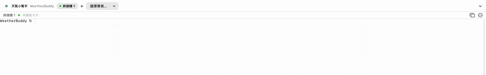
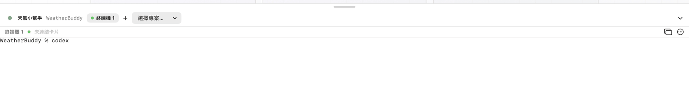
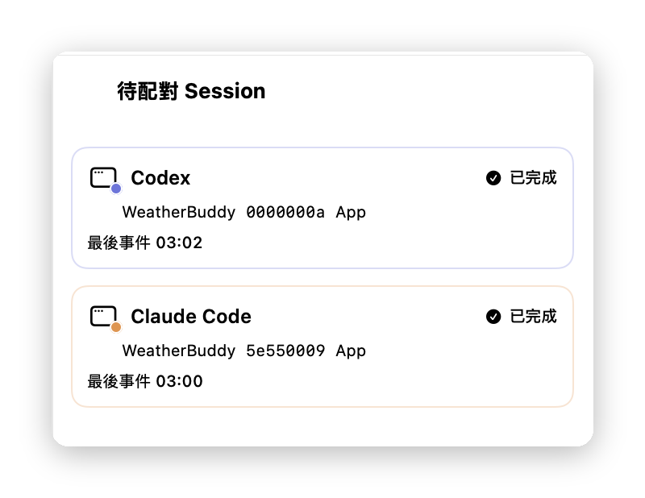
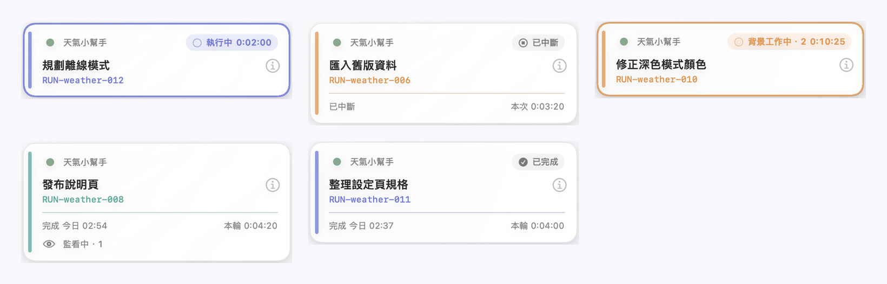
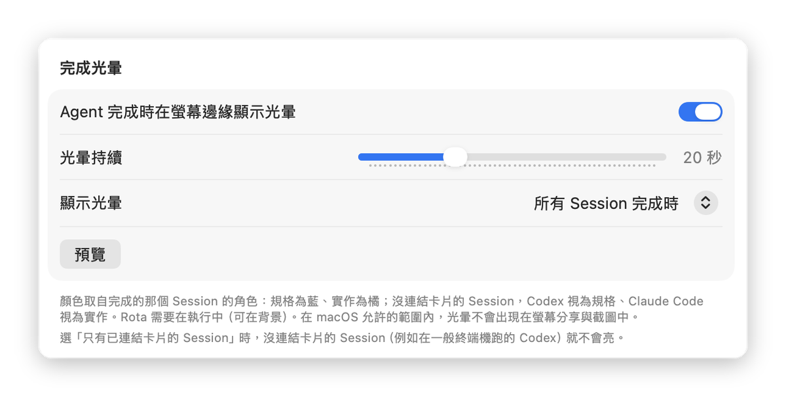
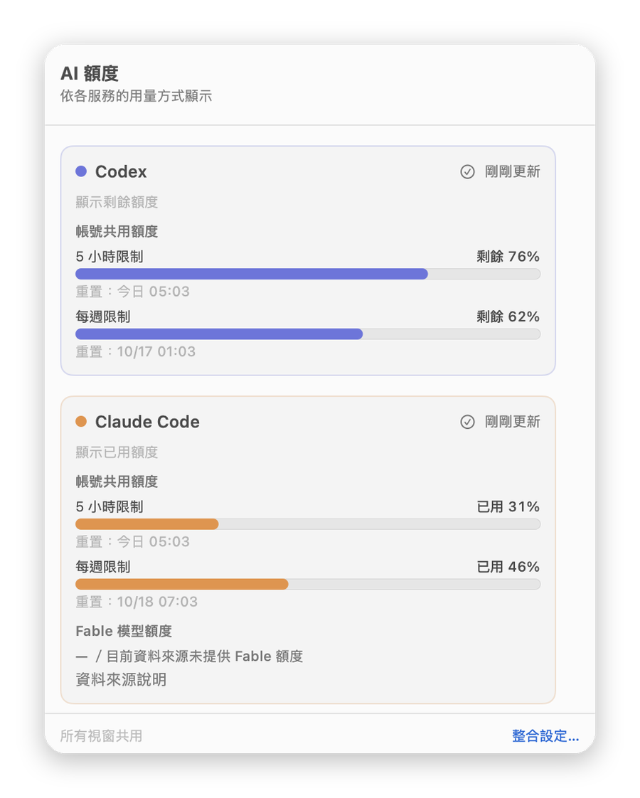
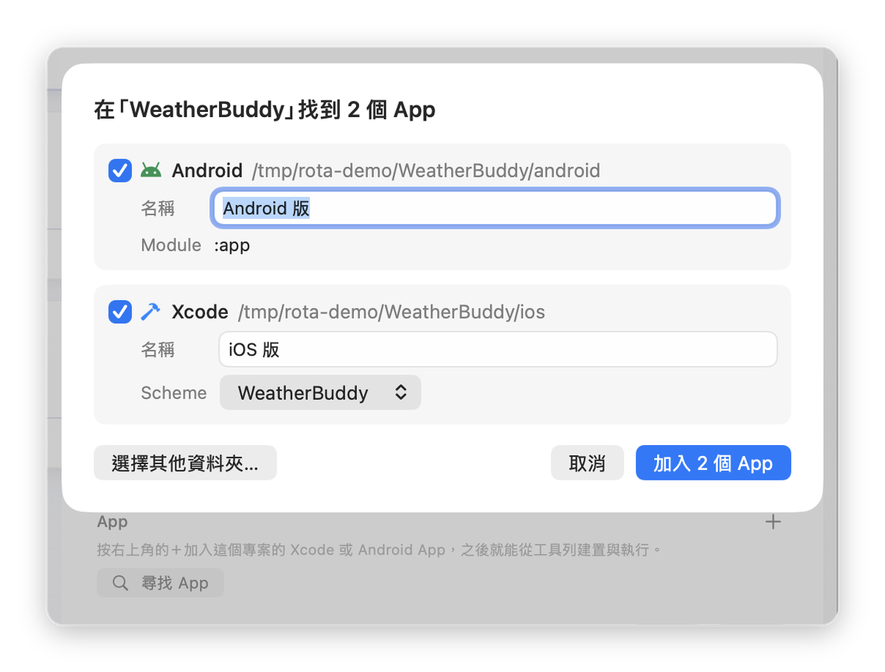
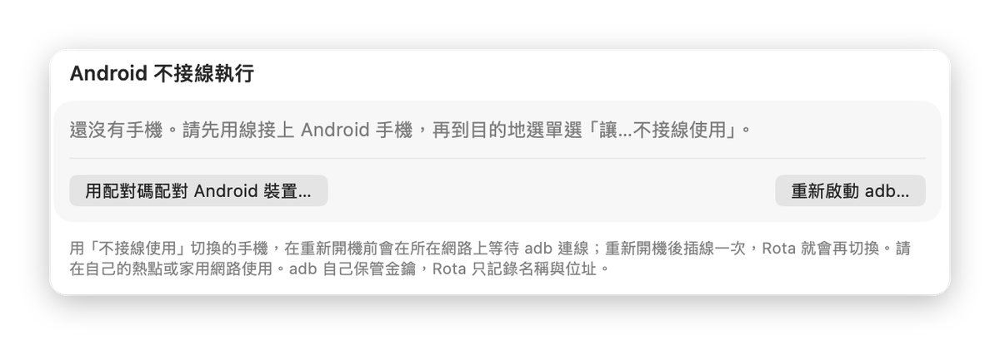
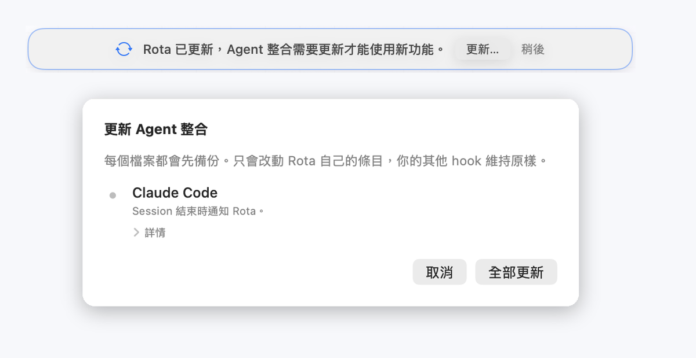

# 使用指南

[← 回到首頁](../README.md) ｜ [English](guide.en.md)

這一頁說明 Rota 裡比較需要說明的操作。還沒完成第一次設定的話，請先看[第一次設定](setup.md)。

- [連結卡片](#連結卡片)
- [待配對 Session](#待配對-session)
- [同時開好幾個終端機](#同時開好幾個終端機)
- [看懂卡片](#看懂卡片)
- [完成光暈](#完成光暈)
- [用量](#用量)
- [執行 App](#執行-app)
- [Android 不接線執行](#android-不接線執行)
- [整合需要更新](#整合需要更新)

## 連結卡片

把 Claude Code 或 Codex 的 Session 連結到卡片之後，卡片才會跟著它的進度移動。每張卡片有「規格」和「實作」兩個位置，各可以連結一個 Session。

### Claude Code

  

1. 在專案的 Rota 終端機輸入 `claude`。
2. 終端機上方會出現「偵測到 Claude Code Session，要連結卡片嗎？」。
3. 專案只有一張進行中的卡片時，按「連結此卡片…」；有好幾張時，按「選擇卡片…」，在列表中選一張。
4. 選擇角色：「規格 · Claude Code」或「實作 · Claude Code」。從列表選卡片時，選好角色後按「連結」。
5. 連結完成後會顯示「已連結到……」，6 秒內可以按「撤銷」取消這次連結。

### Codex

  

Codex 要等你送出第一個 prompt，才會產生 Session。所以 Rota 會在 Codex 一打開時就先問你：

1. 在專案的 Rota 終端機輸入 `codex`，按 Return。
2. 一到三秒內，終端機上方會出現「這個終端機開了 Codex。要連結到哪張卡片？」。
3. 選一張卡片，再選「規格」或「實作」。提示會變成「已預先連結到……，等待 Codex 的第一個 prompt」。
4. 照常送出第一個 prompt，連結會自動完成，不需要再按任何按鈕。

在送出 prompt 之前，按「取消」或結束 Codex，這次預先連結就會作廢，不會連結任何東西。

### 稍後與不要

- **稍後**：先收起提示。之後可以從終端機的「⋯」選單，在「Session 配對」中重新叫出：Claude Code 是「配對 （Session ID）…」，Codex 是「為這個終端機的 Codex 選擇卡片…」。
- **不要**：只出現在 Codex 開啟時的提示。這個 Codex 不會再被詢問；送出第一個 prompt 之後，它的 Session 仍然會照常出現一般的連結提議。
- 沒有連結的 Session 都會留在[待配對 Session](#待配對-session)，之後仍然可以連結。

### 取代已連結的 Session

如果選的位置已經有其他 Session，選擇角色時，那個選項會寫著「（取代 Session ID）」，選它就會取代。如果在你選擇之後，那個位置又換了 Session，Rota 會再問「要取代已連結的 Session 嗎？」，並寫出會被取代的是哪一個。取代只會改變 Rota 的連結，舊的 Session 會留在卡片的 Session 歷史中，不會被刪除。

### 不想看到連結提議

到「設定 → 終端機」，關閉「在 Rota 終端機啟動的 Session 建議連結卡片」。

## 待配對 Session

  

下列 Session 會出現在「待配對 Session」：

- 在 Rota 以外的終端機 App 啟動的 Claude Code 或 Codex；
- 在 Rota 終端機啟動、但還沒連結的 Session，例如按了「稍後」。

按工具列的「待配對 Session」按鈕可以打開這個列表。連結方式有兩種：

- 把 Session 拖到一張卡片上，再選角色，例如「實作 · Claude Code」。連結後 6 秒內可以按「撤銷」。
- 在 Session 上按右鍵，選「連結到…」，再選專案、卡片和角色。

已經結束的 Session 會標示「這個 Session 已經結束，無法再連結。」

## 同時開好幾個終端機

同一個專案可以開好幾個 Rota 終端機，分別執行 Claude Code 或 Codex，各自連結到不同的卡片。連結提議會出現在啟動它的那個終端機上方。

### Codex 的獨立模式

Codex 預設會讓同一台電腦上的 Codex 共用一個背景伺服器。這樣一來，Rota 很難分辨某個 Session 是從哪個終端機來的。

所以在 Rota 終端機裡，`codex` 預設以獨立模式執行，每個終端機各自執行自己的 Codex。這個設定只影響 Rota 的終端機，不會改到你其他的終端機 App 或 Codex 設定。

- 設定位置：「設定 → 終端機 → Rota 終端機中的 Codex 使用獨立模式」。
- 改了設定之後，要**開新的終端機**才會生效。
- Rota 只在開啟 Codex 互動畫面、`resume` 與 `fork` 時加上獨立模式，`codex exec`、`codex agents` 等其他指令照常執行。在獨立模式下，`codex agents` 不會列出這些 Session。
- 目前只支援 zsh。想用共用模式時，關閉這個設定，或在 Rota 終端機輸入 `command codex`。

## 看懂卡片

  

| 卡片上顯示 | 意思 |
|---|---|
| 執行中，以及正在增加的時間 | Claude Code 或 Codex 正在處理這一輪 |
| 完成、時間與「本輪」時長 | 這一輪做完了。「本輪」是從送出 prompt 到完成所花的時間 |
| 背景工作中 · 數字 | 回覆已經結束，但還有 subagent 或背景指令在執行。等它們結束，卡片才會標示完成 |
| 監看中 · 數字 | 只是在等外部事件（例如發布網頁之後的即時訂閱）。這不會擋住完成，卡片照常標示完成 |
| 已中斷 | 這一輪被中斷了，或你手動標記了這一輪已中斷 |

**已知限制**：Claude Code 用 Monitor 工具監看指令時，回報的類型和一般背景指令相同，所以卡片會顯示「背景工作中」，直到監看結束。

### 標記本輪已中斷

如果在 Claude Code 或 Codex 中按了 Esc 中斷，或直接關掉終端機，Rota 可能收不到結束事件，卡片會一直顯示還在進行。這時可以手動標記：

1. 打開卡片的詳細資訊：按卡片右上角的 ⓘ，或在卡片上按右鍵選「打開詳細資訊」（⌘I）。
2. 在「Session」區塊，點那個 Session，或從它旁邊的「⋯」選「Session 詳情…」。
3. 在「Session 詳情」中按「標記本輪已中斷…」，再按「標記已中斷」確認。

這個按鈕只在這一輪還沒結束時出現。標記之後，卡片就會停止計時。

### 封存卡片

打開卡片的詳細資訊，按左下角的「封存卡片…」，確認後卡片就會從看板上移走。之後可以在側邊欄的「封存紀錄」中找到它，隨時恢復。

## 完成光暈

  

Claude Code 或 Codex 完成一輪時，所有螢幕的邊緣會亮起光暈。規格完成是藍色，實作完成是橘色。

在「設定 → 外觀與版面」的「完成光暈」區塊可以調整：

- **Agent 完成時在螢幕邊緣顯示光暈**：開啟或關閉。
- **光暈持續**：3 到 60 秒，預設 20 秒。
- **顯示光暈**：選「所有 Session 完成時」，或「只有已連結卡片的 Session」。選後者時，沒有連結卡片的 Session 完成時不會亮。
- **預覽**：先看一次光暈的樣子。

光暈不會搶走焦點，也點不到。系統開啟「減少動態效果」或低耗電模式時，光暈只會淡入淡出，沒有其他動畫；開啟「減少透明度」時，會改用一圈實心的邊框，沒有模糊效果。

## 用量

  

工具列上有一個用量按鈕，顯示量表圖示和用量數字（還沒開啟時寫「未啟用」）。按下去會打開「AI 額度」面板，看到 Claude Code 和 Codex 的 5 小時與每週用量。Codex 顯示的是剩餘多少，Claude Code 顯示的是已經用了多少，和各自的服務顯示方式相同。

### 開啟帳號用量

Claude Code 和 Codex 的用量都要另外開啟，兩個可以分開設定：

1. 到「設定 → Agent 整合」的「帳號用量」區塊。
2. 開啟「Codex 帳號用量」：Rota 會在背景執行一個 `codex app-server`，只讀取帳號的用量上限。
3. 開啟「Claude Code 帳號用量」：Rota 會安裝自己的 Claude Code status line，取代終端機最下面那一列提示。如果你已經設定了其他 status line，這個開關無法開啟，Rota 會寫出原因，不會取代你的 status line。
4. Claude Code 回覆一次之後，Claude Code 的用量就會出現。

如果面板寫「需要較新版本的 Claude Code Session」，請更新 Claude Code，再開一個新的 Session。

## 執行 App

  

### 加入 App

1. 在側邊欄的專案上按右鍵，選「專案設定…」。
2. 在「App」區塊按「尋找 App」。已經加入過 App 時，改按區塊右上角的「＋」，選「在「資料夾名稱」中尋找 App」。Rota 會在專案資料夾裡找 Xcode 專案與 Android 專案。找不到的話，從「＋」選「選擇資料夾…」指定位置；選得太上層或太下層都沒關係，Rota 會自己找到 App 的根目錄。
3. 確認找到的 App，按「加入 App」。每一個 App 會顯示 ✅ 或 ⚠；⚠ 代表需要修正，旁邊會寫出原因。工具列上出現 ⚠ 時，點它會打開專案設定並標出那一列。

### 執行與停止

1. 在工具列選 App，再選目的地。
   - Xcode：我的 Mac（macOS App 才有）、iPhone 實機、iOS 模擬器。
   - Android：已連線的手機、執行中或尚未啟動的模擬器。
2. 按「▶︎」執行，按「■」停止。
3. 工具列的狀態按鈕可以打開執行紀錄，看建置與執行的輸出。

說明：

- 同一時間只會執行一個 App。執行中再按「▶︎」，Rota 會先告訴你要停止哪一個、接著執行哪一個。
- 執行 App 不會占用專案的終端機。
- 結束 Rota 時，進行中的建置會一起停止；已經打開的 App 和模擬器不受影響。

### iPhone 在目的地選單中是灰的

灰掉的 iPhone 後面會寫出原因：

- **「需要 iOS xx」**：App 要求的最低 iOS 版本比手機的版本新。請在 Xcode 調低 Minimum Deployments，或更新手機。
- **「尚未配對：先用線連接一次並信任這台 Mac」**：用線把 iPhone 接上 Mac，在手機上選擇信任這台電腦。
- **「未連線」**：用線接上 iPhone，或讓 iPhone 和 Mac 連上同一個網路。
- **「開發者模式未開啟」**：在 iPhone 的「設定 → 隱私權與安全性 → 開發者模式」中開啟。

改完之後，在目的地選單按「重新整理」。

## Android 不接線執行

  

### 用手機熱點（建議）

1. 用 USB 線把手機接上 Mac，手機上允許 USB 偵錯。
2. 在目的地選單的「不接線」區塊，選「讓「手機名稱」不接線使用…」，再按「不接線使用」確認。Rota 會記住這支手機。
3. 拔掉線，讓 Mac 連上這支手機的熱點。
4. 在目的地選單選這支手機，按「▶︎」。

目的地選單會顯示目前的連線方式：有線、熱點、無線（同一個 Wi-Fi），或未連線（按「▶︎」時 Rota 會先連線）。

### 用配對碼（同一個 Wi-Fi）

手機和 Mac 在同一個 Wi-Fi 時，可以不接線直接配對：

1. 在手機的「開發人員選項 → 無線偵錯」中，選「使用配對碼配對裝置」。
2. 在 Rota 的目的地選單或設定中，選「用配對碼配對 Android 裝置…」，輸入手機上顯示的配對碼。

### 手機重新開機之後

手機重開機後，無線連線會失效。用線接上一次，Rota 會自動切回無線（「插線時自動切換為無線」預設開啟）。之後就可以拔線。

### 設定與疑難排解

「設定 → 進階與診斷 → Android 不接線執行」可以：

- 看已記住的手機，或移除手機；
- 切換「插線時自動切換為無線」；
- 用配對碼配對；
- 查看最近的無線紀錄；
- 重新啟動 adb（會先詢問）。

三星手機的「自動封鎖程式」可能會讓 USB 與無線偵錯無法使用，遇到問題時請先在手機上關閉它。

## 整合需要更新

  

更新 Rota 之後，如果 Claude Code 或 Codex 的整合需要跟著更新，主視窗上方會出現提示。

1. 按「更新…」，表單會列出每一項要新增或移除的內容。
2. 按「全部更新」。Rota 會先備份設定檔，寫入失敗時會自動還原。
3. 如果有更新 Codex，表單會列出之後要在 Codex 中做的事：執行 `/hooks` 核准 Rota 的 hook，用 `/exit` 結束 Codex 再重新開啟，然後送出一個 prompt。

之後在 Claude Code 或 Codex 送出一次 prompt，「設定 → Agent 整合」中的狀態就會變回已啟用。
